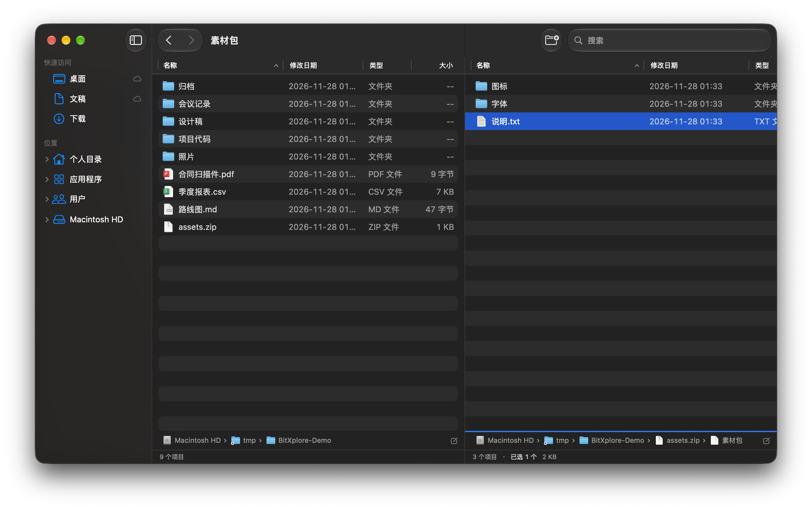
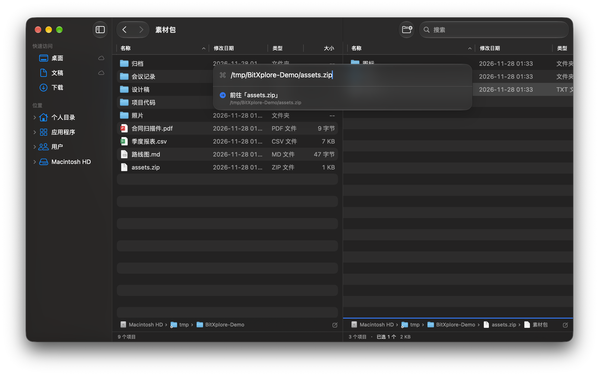

# BitXplore

原生 SwiftUI 打造的 macOS 文件管理器：双栏视图、全键盘操作、像文件夹一样浏览 ZIP，零第三方依赖。

开发流程（环境准备、日常构建、代码规范、发布与升级）见 [docs/development-guide.md](docs/development-guide.md)。下载安装包请到 [Releases](https://github.com/Nonnika/BitXplorer/releases)。

## 截图





## 相比访达（Finder）

| | Finder | BitXplore |
|---|---|---|
| **双栏** | 只能开两个窗口或标签页来回切换 | ⌘D 一键双栏，栏间直接拖拽，⌘← / ⌘→ 切换 |
| **ZIP** | 必须先解压才能看内容 | 像文件夹一样直接进入，包内文件可打开、预览、拖出，拖入即加入压缩包 |
| **前往路径** | ⇧⌘G 只认标准路径 | ⌘⌥P 命令面板，带引号、`file://`、终端转义、相对路径都能识别 |
| **键盘** | 进入文件夹要按 ⌘↓，→ 只是展开 | ↑↓ 选择、→ 进入、← 返回并选中来处、空格预览、Delete 删除 |
| **终端** | 仅系统「终端」，且要先在「服务」中启用 | 右键「在终端中打开」，自动列出已装终端，可自选任意终端 App |
| **复制路径** | 需按住 ⌥ 才出现 | 右键直接复制路径 / 名称，多选按行拼接 |

## 功能

**浏览与导航**
- 双栏视图（⌘D），⌘W 关闭当前栏，⌘[ / ⌘] 或拖动分隔条调整宽度
- 侧边栏「快速访问」可拖入、排序、自定义图标；「位置」为完整目录树；iCloud 文件夹显示云标
- 命令面板（⌘⌥P）：粘贴或输入路径前往，文件路径会打开所在目录并选中该文件；输入 `/` 搜索当前目录下的文件（文件列表中直接按 `/` 即可，与 Vim 键位开关无关），↑↓ 选择、回车定位：
  - 语法 `/名称/范围/类型`，范围与类型可省略、顺序随意
  - 名称：默认为「包含」；含 `*` 时整个文件名按通配匹配（如 `*.md`、`IMG_*`），`\*` 匹配星号本身
  - 名称整段写成 `$REGX(正则)` 时按正则表达式在文件名中查找，不区分大小写、不自动锚定（需整名匹配自加 `^` `$`）；因为先按 `/` 切段，正则里不能含 `/`
  - 范围：`g` 不限层级（默认），`d:N` 最多 N 层（`d:1` 只搜当前目录）
  - 类型：`f` 只要文件，`d` 只要文件夹，默认都要
  - 例：`/*.md/d:2/f` 当前目录及下一层的 Markdown 文件；`/src/d` 名称含 src 的文件夹；`/$REGX(^img_\d{4})/f` 以 IMG_ 加四位数字开头的文件
- 命令面板批量改名：`%s/文件路径/目标/替换`，把文件名中的目标文字换成替换文字；输入时实时预览每个文件的新名字，回车执行：
  - 路径：一个文件（不能是文件夹，相对当前目录），或用 `$(命令)` 嵌入另一条面板命令、以其结果为输入，如 `$(/*.png/f)`；结果中的文件夹会跳过
  - 变量：`$FILENAME` 为当前处理文件的名字（含扩展名），`$SUFFIX` 为其扩展名（1.png 为 `png`）；`$DATETIME(格式)` 为今天的日期，`yy` `mm` `dd` 输出 2005 09 01，单个 `y` `m` `d` 输出 05 9 1，其余字符（`/` `-` 等）原样输出，可省略；不带括号即 `yy-mm-dd`
  - 目标区分大小写，文件名中所有匹配处都会替换：`*` 为通配（任意长度），`$REGX(正则)` 嵌入正则表达式，二者可与文字、变量混用（如 `IMG_$REGX(\d+)`）；其余按字面。替换文字按字面插入，不支持 `$1` 分组引用
  - 文本中的 `/` `$` `*` `\` 写作 `\/` `\$` `\*` `\\`
  - 改名后与已有文件或同批其他文件重名、名称不合法的会标出并跳过，不会覆盖
  - 例：`%s/.\/1.png/$FILENAME/1+$FILENAME` 把 1.png 改为 1+1.png；`%s/$(/*.jpg/f)/.jpg/-$DATETIME(yymmdd).jpg` 给所有 jpg 加上日期后缀；`%s/$(/*/f)/IMG_$REGX(\d+)/photo` 把 IMG_001.png 改为 photo.png
- 右键「神奇重命名…」：批量改名的图形版，填「查找」「替换为」即可，变量与规则同上（此处 `/` 是普通字符），输入框同样语法高亮，下方实时预览新名字；回车执行，Tab 切换输入框
- 命令面板输入实时语法高亮：分隔符、选项、通配、转义、变量分色显示，无法识别的选项或变量标红
- 底部路径栏可点击跳转，也可切换为输入框编辑路径
- 搜索（⌘F）实时过滤当前目录；列头点击排序
- 外部增删文件时列表自动刷新

**文件操作**
- 拖放：拖入文件夹、拖出到 Finder / 其他 App、双栏互拖；同卷移动，跨卷或按住 ⌥ 复制
- ⌘N 新建「未命名文件夹」并进入重命名；F2 / 右键重命名
- ⌘C / ⌘X / ⌘V 复制剪切粘贴，同名冲突可选替换 / 保留两者 / 跳过
- Delete 或 ⌘⌫ 移到废纸篓（先确认）
- 空格快速查看（系统 Quick Look，从图标缩放弹出，↑↓ 切换预览）
- 右键菜单：打开方式、在另一栏中打开、创建副本、压缩 / 解压、复制路径与名称、在 Finder 中显示、在终端中打开、添加到快速访问

**ZIP**
- 直接浏览，支持中文文件名（UTF-8 / GBK）与 ZIP64（>4 GB）
- 包内文件可打开、预览、拷贝、拖出；拖入文件即加入压缩包

**其他**
- 首次启动引导授予「完全磁盘访问权限」（帮助菜单可再次打开）
- 菜单与界面全中文

## 快捷键

| 快捷键 | 功能 |
|---|---|
| ↑ ↓ | 选择文件（无焦点时从可见的第一个开始） |
| → / ← | 进入文件夹 / 返回上一级 |
| Return | 打开 |
| 空格 | 快速查看 |
| Delete、⌘⌫ | 移到废纸篓 |
| ⌘N | 新建文件夹 |
| ⌘D / ⌘W | 开启双栏 / 关闭当前栏 |
| ⌘← / ⌘→ | 切换到左栏 / 右栏 |
| ⌘[ / ⌘] | 分隔条左移 / 右移 |
| ⌘⌥P | 命令面板 |
| ⌘F | 搜索 |
| ⇧⌘G | 编辑路径 |
| ⌘↑ / ⌘↓ | 上一级 / 原路返回下一级 |
| ⇧⌘. | 显示 / 隐藏隐藏文件 |

## Vim 键位

默认开启，可在「显示 › Vim 键位」关闭（关闭后字母键恢复为按首字母跳转）。文件列表获得焦点时生效：

| 按键 | 功能 |
|---|---|
| `j` / `k` | 下一个 / 上一个（可按住连续移动） |
| `h` 或 `-` / `l` | 返回上一级 / 进入文件夹或打开文件 |
| `gg` / `G` | 第一项 / 最后一项 |
| `Ctrl-d` / `Ctrl-u` | 向下 / 向上移动 10 行 |
| `gh` | 回到个人目录 |
| `yy` / `dd` / `p` | 复制 / 剪切 / 粘贴 |
| `cw` | 重命名 |
| `/` | 命令面板搜索文件（关闭 Vim 键位也可用） |
| `:` | 命令面板；在工具栏搜索框中先按 `Esc` 回到列表再按 `:` |

## 系统要求

macOS 27.0 或更高版本。

## 构建 & 运行

```bash
./build_and_run.sh
```

增量编译本机架构的 Debug 产物并重启应用（约 1 秒）。需要断点调试时可 `open Package.swift` 用 Xcode 打开。

ZIP 解析与压缩 / 解压逻辑有一份无框架自检：

```bash
scripts/zip_check/run.sh
```

命令面板文件搜索（语法解析、通配、层级与类型过滤）的自检：

```bash
scripts/search_check/run.sh
```

命令面板批量改名（语法解析、变量、日期格式、重名检查）与语法高亮的自检：

```bash
scripts/replace_check/run.sh
```

## 打包为 dmg

```bash
./package_app.sh
```

构建 x86_64 / arm64 / Universal 三个架构并打包成 dmg，**产物统一输出到 `build/`**（不入库）：

```
build/BitXplore_<版本>-amd64.dmg
build/BitXplore_<版本>-arm64.dmg
build/BitXplore_<版本>-universal.dmg
```

版本号的唯一来源是 `Sources/BitXplore/AppVersion.swift`，**发版前手动递增**。多架构构建需要完整的 Xcode（脚本默认使用 `/Applications/Xcode.app`）。

升级已安装的版本：把新 app 拖入「应用程序」选「替换」即可。应用只在偏好设置中保存四项内容（是否看过引导、自选终端、快速访问列表、Vim 键位开关），覆盖安装不受影响。

## 项目结构

```
BitXplorer/
├── Package.swift                  # SwiftPM 配置（嵌入 Info.plist 使系统菜单显示中文）
├── build_and_run.sh               # Debug 增量构建 + 重启应用
├── package_app.sh                 # Release 打包 dmg（三架构，输出至 build/）
├── generate_icon.swift            # 用代码生成 App 图标
├── scripts/zip_check/             # ZIP / 压缩解压 / 路径解析自检
├── docs/development-guide.md      # 开发流程
└── Sources/BitXplore/
    ├── AppVersion.swift           # 版本号定义
    ├── BitXploreApp.swift         # 入口、菜单命令、关于窗口
    ├── Info.plist                 # 嵌入 debug 二进制的语言声明
    ├── Models/
    │   ├── FileItem.swift         # 文件数据模型与排序
    │   ├── Pane.swift             # 单个面板状态（目录、选中、上/下级导航）
    │   └── TreeNode.swift         # 侧边栏节点与快速访问条目
    ├── Services/
    │   ├── FileSystemService.swift # 文件操作、拖放、压缩解压、终端、路径解析
    │   ├── FileSearch.swift       # 命令面板文件搜索
    │   ├── TextReplace.swift      # 命令面板批量改名 %s
    │   ├── CommandSyntax.swift    # 命令面板语法高亮
    │   └── ZipArchive.swift       # ZIP 中央目录解析、解压、加入
    └── Views/
        ├── MainContentView.swift  # 工具栏、双栏布局、面板（加载 / 监视 / 焦点）
        ├── FileListView.swift     # 文件列表、右键菜单、拖放、Quick Look
        ├── SidebarTreeView.swift  # 侧边栏：快速访问 + 目录树
        ├── BreadcrumbBar.swift    # 底部路径栏
        ├── CommandPalette.swift   # 命令面板
        ├── MagicRenameView.swift  # 右键「神奇重命名」
        └── OnboardingView.swift   # 首次启动授权引导
```

## 许可

MIT
